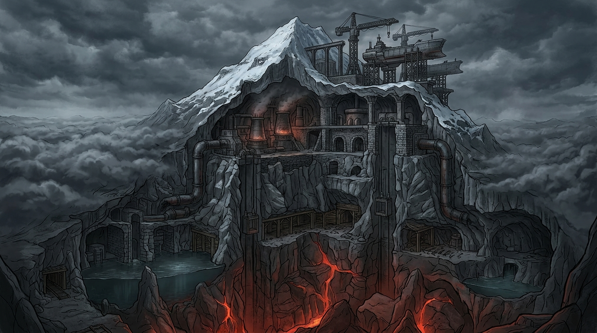

# The Mountain (*Faírguni*)

> *"Human civilization lives entirely inside a continent-sized mountain, measuring space vertically: Up-Mountain, Down-Mountain, Coreward, and Rimward."*  
> — **RULING 004 & RULING 030 (Locked Canon)**

---

## 🗺️ Architectural Elevation Base Map



*Downloadable full-resolution base map available at:* `Fairguni_Arcology_Map_Clean_16x9.jpg` *and* `Fairguni_Arcology_Map_Clean_4x3.jpg`.

---

## 🧭 In-World Spatial Coordinate System

Space inside Fairguni is stacked vertically within a closed volcanic arcology. Cardinal directions are replaced by four structural vectors:

| Vector | Heading | Operational Meaning |
| :--- | :--- | :--- |
| **Up-Mountain** | $\uparrow$ Ascending | Toward the Spire, filtered atmospheric intake, registry archives, and summit ark gantries. |
| **Down-Mountain** | $\downarrow$ Descending | Toward the deep hearths, Lower Four, heavy industrial sumps, standing water, and black-damp. |
| **Coreward** | $\rightarrow$ Inward | Toward the central volcanic chimney, geothermal heat pipes, and the Volcanic Shear. |
| **Rimward** | $\leftarrow$ Outward | Toward the outer mountain flanks, cold dead galleries, and external cloud vents. |

---

## 📍 World Anvil & Archive Pin Directory

Use this reference to place interactive markers directly onto the clean base map:

```
[+4,200m] ─── ⚓ SUMMIT ARK GANTRIES (Dreadnoughts I–VI; 600k capacity)
                │
[+3,500m] ─── 🏛️ TIER NINE BALCONY (Theodemir / Ministry of Allocation)
                │
[+2,800m] ─── 💧 GREAT NORTH AQUEDUCT (30-mile pressurized intake flues)
                │
[+2,200m] ─── 🔨 FOUNDRY BAY NINE (Heavy blast furnaces & scrap skips)
                │
[+1,400m] ─── 🌲 TIMBERMEN GUILD (Fossilized trunks; 40k workers)
                │
[  +800m] ─── 🍄 BRACKET-FUNGUS CAVERNS (Caloric ration mash vats)
                │
[  +150m] ─── 🛑 SHAFT 44 (Magnetite sill breach; Varek's stand)
                │
[  -100m] ─── ⚒️ DRIFT 14 (Kaelen's forge & Bram's record desk)
                │
[  -250m] ─── 👶 COMMUNAL NURSERY (Hand-cranked drainage pump)
                │
[  -400m] ─── 📜 AZG-HAÍMS (Volcanic Shear life-tithe desk)
                │
[-1,200m] ─── 🌋 RISING MAGMA FRONT (11–28 year breach clock)
```

---

## ⚙️ The Living Corpse Demographic (10:1 Contraction)

* **Peak Historical Capacity:** ~42,000,000 (arcology engineered at peak ~3,000 years ago).
* **Current Surviving Population:** **~4,200,000 Thulans**.
* **The Living Corpse Reality:** Ten people inhabit infrastructure engineered for a hundred. Surviving districts are isolated islands in dark basalt silence:
  * Miles of heavy lift trunks are welded shut to conserve power.
  * Transit platforms sized for millions now host small shift crews.
  * Municipal aqueducts built for eight million carry a pressurized trickle.
  * Communal halls engineered for two thousand seat eighty.

---

## 🌋 The Encroachment Clock

While recoverable iron and copper ore remains for 30–50 years, the subterranean magma chamber rising beneath the lower hearths will breach the deep sumps in **11 to 28 years** ([RULING 004](file:///home/aaron/repos/thulans-production/RULINGS.md#ruling-004-the-mountain-fairguni--the-great-acceleration)). 

This geological reality is the hidden clock behind the Council's priority construction of the six evacuation arks: *the authorities accelerating production are doing so precisely because they know the Mountain cannot be saved.*
