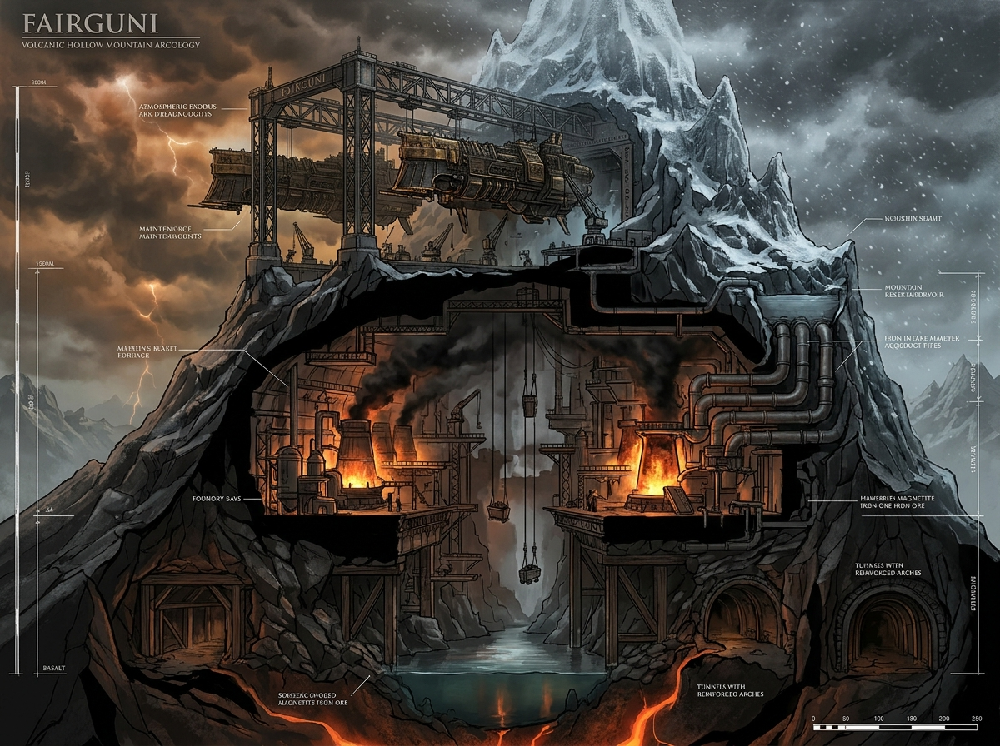
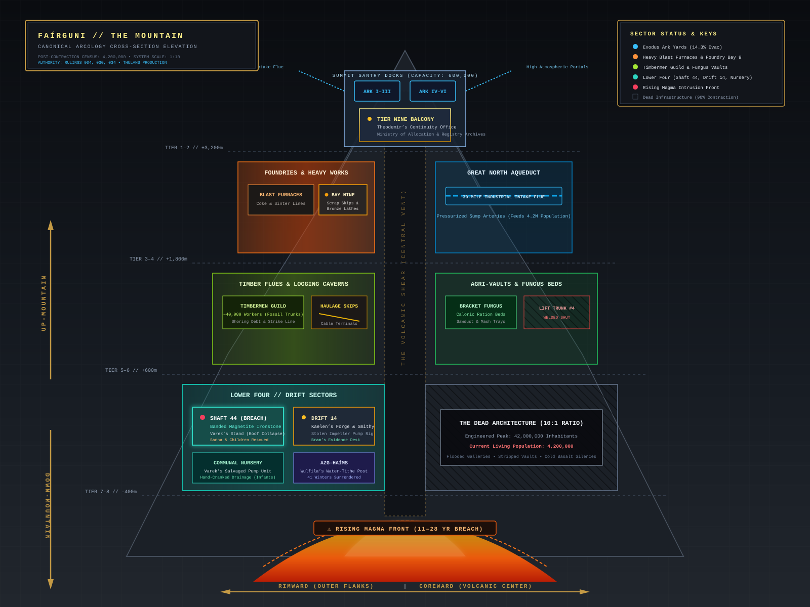

# The Mountain (*Faírguni*)

> *"Human civilization lives entirely inside a continent-sized mountain, measuring space vertically: Up-Mountain, Down-Mountain, Coreward, and Rimward."*  
> — **RULING 004 & RULING 030 (Locked Canon)**

---

## 🗺️ Canonical Architectural Cross-Section

  

---

## 🧭 The Spatial Coordinate System

Because human civilization inside Fairguni is stacked vertically inside an enclosed volcanic massif with no accessible sky, traditional cardinal directions (North, South, East, West) have no meaning to ordinary citizens. Space is measured along two primary axes:

| Direction | Orientation | Functional Meaning |
| :--- | :--- | :--- |
| **Up-Mountain** | $\uparrow$ Ascending | Toward the Spire, council registries, filtered atmospheric air, and the summit ark gantries. |
| **Down-Mountain** | $\downarrow$ Descending | Toward the industrial sumps, Lower Four, heavy ore drifts, standing water, and black-damp. |
| **Coreward** | $\rightarrow$ Central | Toward the central volcanic chimney, geothermal heat pipes, and the Volcanic Shear. |
| **Rimward** | $\leftarrow$ Flank | Toward the outer perimeter walls, dead abandoned galleries, and external storm-cloud vents. |

---

## ⚙️ The Living Corpse Demographic (10:1 Contraction)

* **Peak Engineered Capacity:** ~42,000,000 inhabitants (engineered ~3,000 years ago during the high-tech zenith).
* **Current Surviving Population:** **~4,200,000 inhabitants**.
* **The Structural Reality:** Ten people inhabit infrastructure engineered for a hundred. Fairguni is not an overcrowded hive; it is an **enormous dying machine** where dense surviving communities are isolated islands surrounded by vast dark silences:
  * Miles of heavy lift trunks are welded shut to conserve power.
  * Transit platforms sized for millions now host dozens.
  * Municipal aqueducts built for eight million carry a pressurized trickle.
  * Vaulted communal dining halls built for two thousand seat eighty.

---

## 🏛️ The Four Primary Strata

### 1. The Summit & The Spire (Elev. +3,200m to +4,500m)
* **The Exodus Ark Yards:** High gantry docks cradling the six atmospheric dreadnoughts (*Arks I through VI*). Total evacuation capacity is strictly capped at **600,000 berths** (~14.3% survival ratio). Approximately 3.6 million Thulans cannot leave.
* **Tier Nine Command Balcony:** The administrative seat of Theodemir and the Ministry of Allocation. Overlooks the chasm of the central volcanic rift.
* **The High Archives:** Air-filtered ledgers tracking caloric allowances, water quotas, and the Life Tithe. Citizens here breathe filtered atmospheric air and consume clean wheat bread.

### 2. The Upper Works & Foundries (Elev. +1,800m to +3,200m)
* **Great North Aqueduct:** The thirty-mile intake flues that supply pressurized water to the surviving 4.2 million.
* **Foundry Bay Nine:** Heavy blast furnaces, rolling mills, and guild machine shops. Site where the drift smith Kaelen scavenged the bronze impeller used to build unmetered drainage pumps.
* **Heavy Rolling Works:** Where guild ironwrights manufacture boiler shells and structural shoring pins.

### 3. The Timber Flues & Mid-Levels (Elev. +600m to +1,800m)
* **The Timbermen Guild:** Approximately 40,000 specialized loggers working fossilized subterranean tree trunks. Timber debt, shoring shortages, and timber strike threats govern the safety of all lower drifts.
* **Bracket-Fungus Farms:** Massive horizontal cavern beds growing caloric mash, sawdust cakes, and algae vats that feed the industrial workforce.
* **Cable Skip Terminals:** The counterweighted haulage skip system that moves raw ore upward and timber downward.

### 4. Lower Four & The Deep Hearths (Elev. -400m to +600m)
* **Shaft 44:** Banded magnetite-ironstone (*blôþ-stáin* / hematite skarn). The canon site of the catastrophic roof collapse where Varek Fairgunjis braced his three-tonne frame to protect Sanna and six infants.
* **Drift 14:** The working heart of the lower smithies, housing Kaelen’s forge and Bram’s record desk.
* **The Communal Nursery:** The flooded lower-drift shelter where Varek's salvaged bilge pump was retrofitted for hand operation.
* **Azg-Haíms:** The precinct of the Volcanic Shear where young miners surrender their life-tithes (e.g. Wulfila’s 41 winters of sweet water).

---

## 🌋 The Encroachment Clock

While the Mountain possesses 30–50 years of recoverable iron and copper ore, the rising magma chamber beneath the lower hearths will breach the deep sumps in **11 to 28 years**. 

This geological reality is the **hidden clock** behind the Council’s acceleration of the atmospheric arks: *the people destroying the Mountain fastest are doing so precisely because they know it is dying.*
